# 🔐 Week 3 – Cybersecurity Practical Labs

This repository contains hands-on cybersecurity practical exercises focused on password cracking, password recovery, and password security.

## 🎯 Labs Covered

### 🔹 W3-PM1: Password Cracking with John the Ripper (JTR)

**Objective:** Recover passwords from three password-protected PDF files using John the Ripper and Johnny.

**Tools Used:**
- John the Ripper (JTR)
- Johnny (GUI version of JTR)
- Online Hash Calculator – [OnlineHashCrack](https://www.onlinehashcrack.com/)

**Practical Overview:**
- Learned about password cracking and password hashes.
- Explored John the Ripper and its graphical interface, Johnny.
- Extracted password hashes from protected PDF files.
- Used JTR and Johnny to perform password recovery.
- Successfully recovered passwords from three files.

  **📸 Practical Screenshot of Password Cracking using JTR**
  <h2>File1</h2>
  <h3> Hash Calculator</h3>
  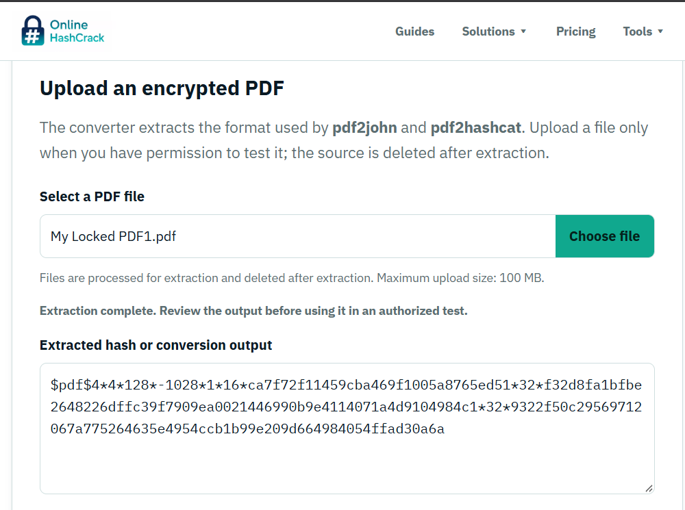
  <h3> Johnny Interface</h3>
   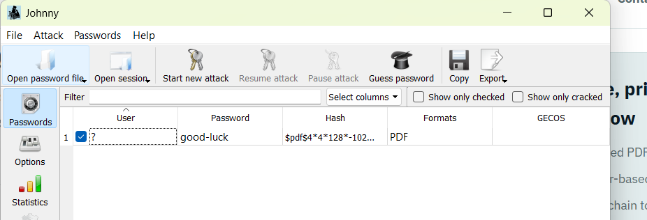
   <h3> Password Recovery</h3>
   

   <h3>File22</h3>
  <h3> Hash Calculator</h3>
  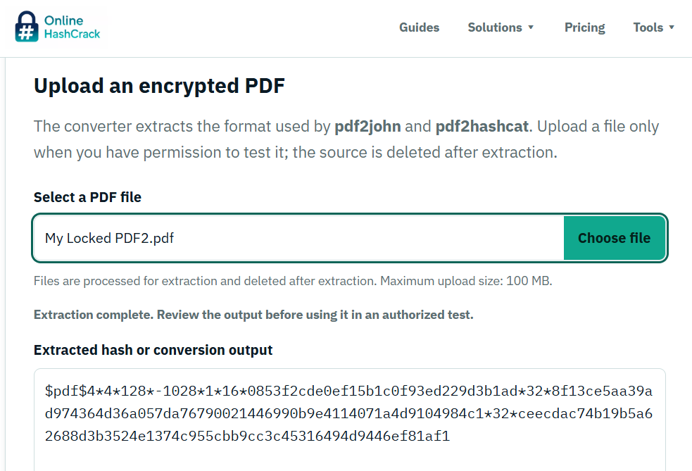
  <h3> Johnny Interface</h3>
   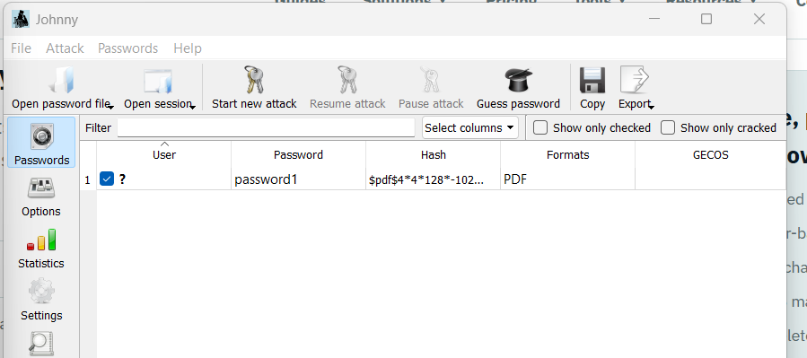
   <h3> Password Recovery</h3>
   
   
   <h2>File3</h2>
  <h3> Hash Calculator</h3>
  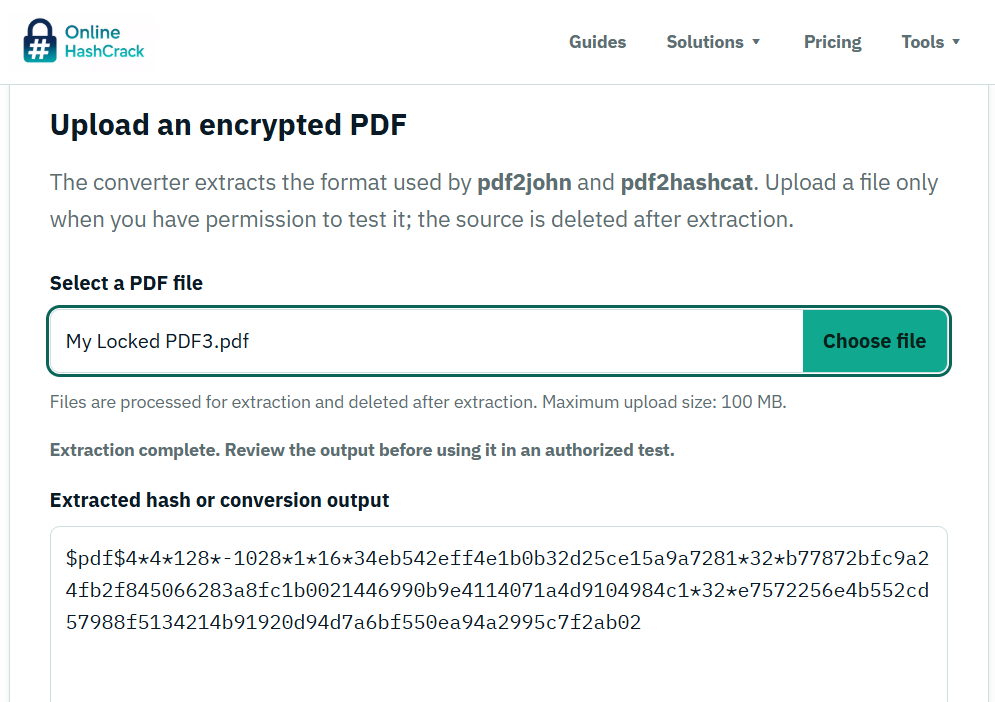
  <h3> Johnny Interface</h3>
   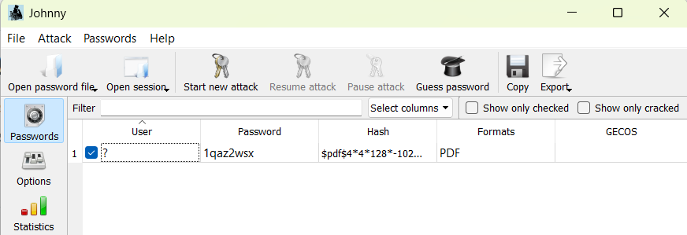
   <h3> Password Recovery</h3>
   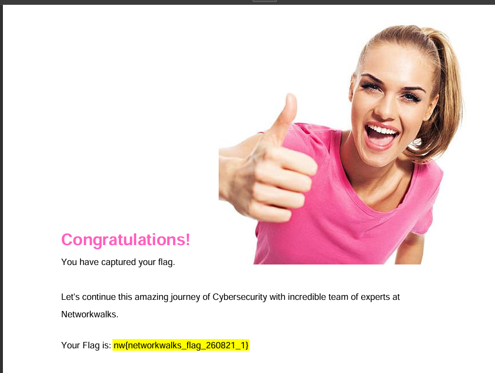

### 🔹 W3-PM2: Password Cracking with NW Tools

**Objective:** Understand password recovery using Networkwalks' online tools.

**Tools Used:**
- Networkwalks Hash Calculator
- Networkwalks Password Cracker

**Practical Overview:**
- Learned about password hashes and password-cracking techniques.
- Used the Hash Calculator to extract the hash from a password-protected PDF file.
- Submitted the extracted hash to the Password Cracker.
- Recovered the original password using the online tool.
- Understood why weak and commonly used passwords are vulnerable.

  
  **📸 Practical Screenshot of Password Cracking using NetworkWalks Tools**
  <h2>File1</h2>
  <h3> Hash Calculator</h3>
  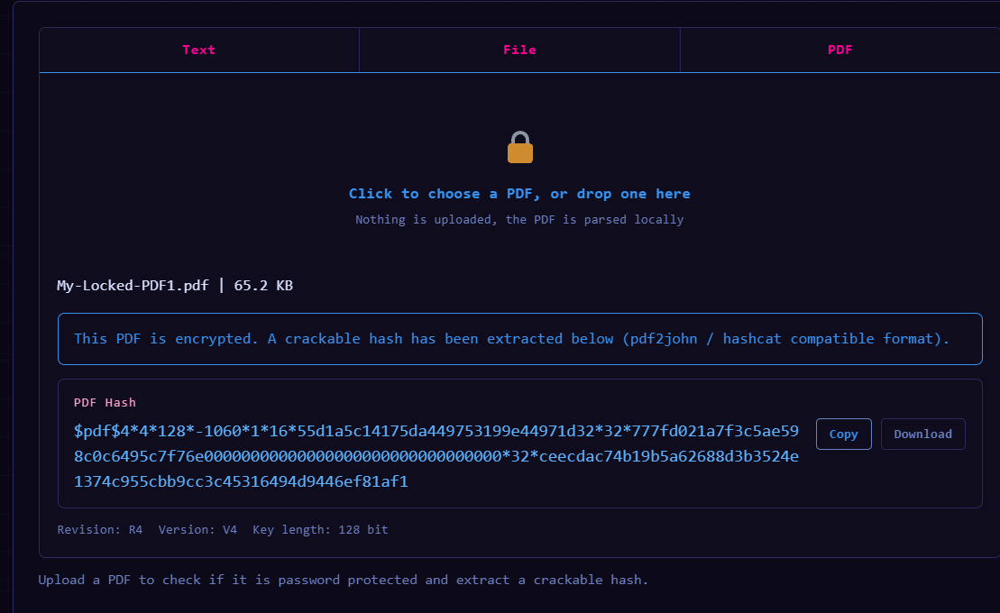
  <h3> Password Cracker</h3>
   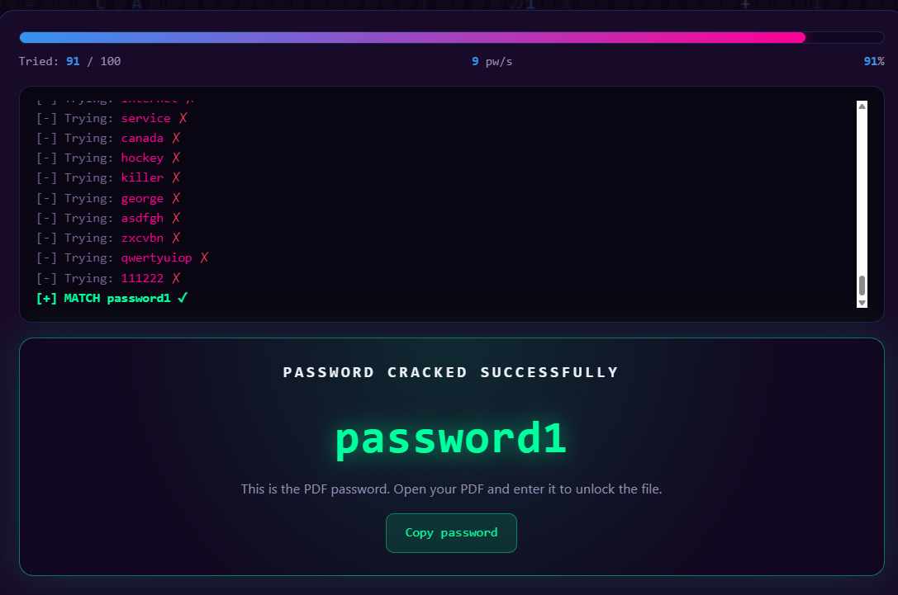
   <h3> Password Recovery</h3>
   

   <h3>File22</h3>
  <h3> Hash Calculator</h3>
  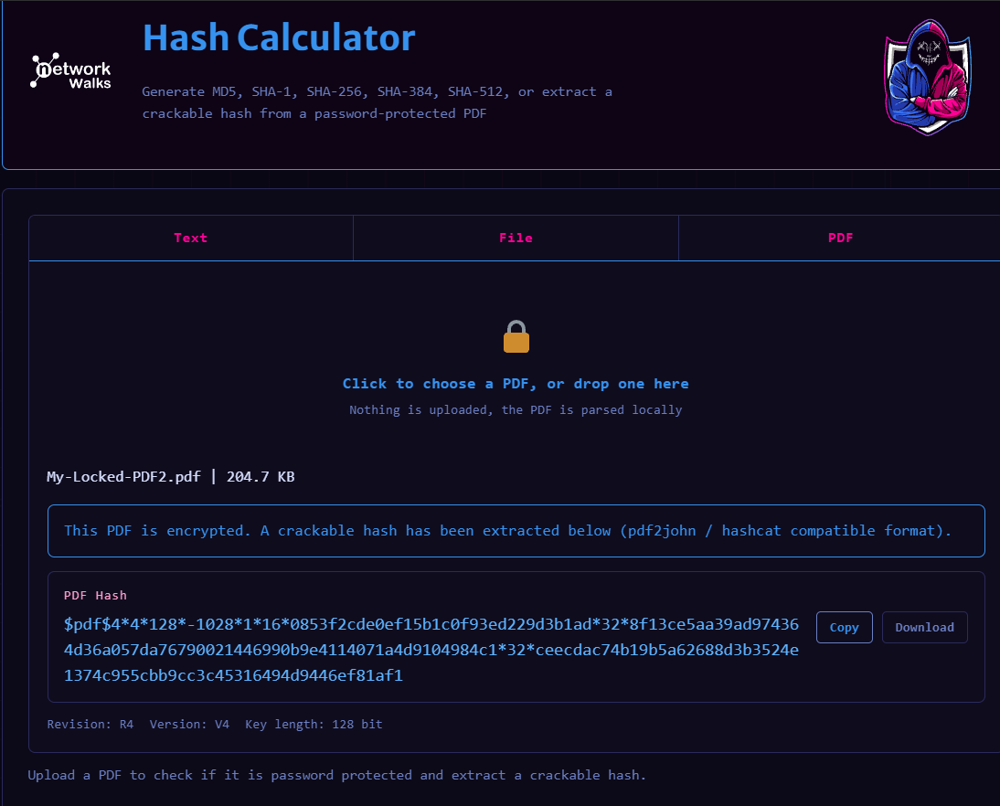
  <h3> Password Cracker</h3>
   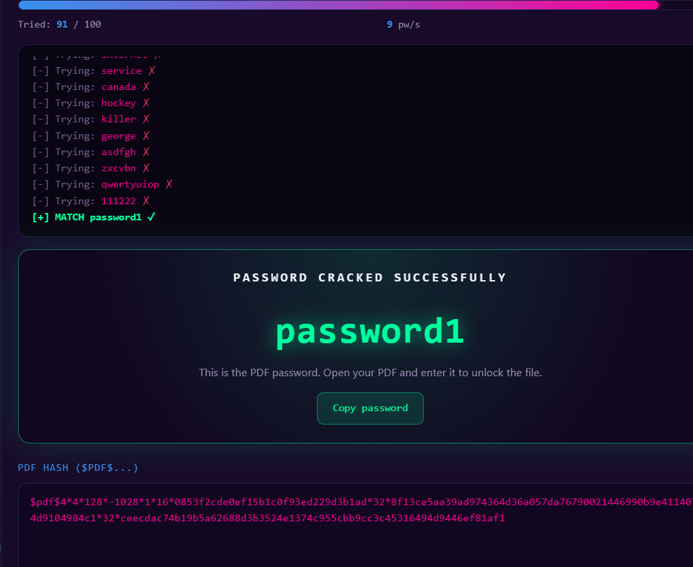
   <h3> Password Recovery</h3>
   
   
   <h2>File3</h2>
  <h3> Hash Calculator</h3>
  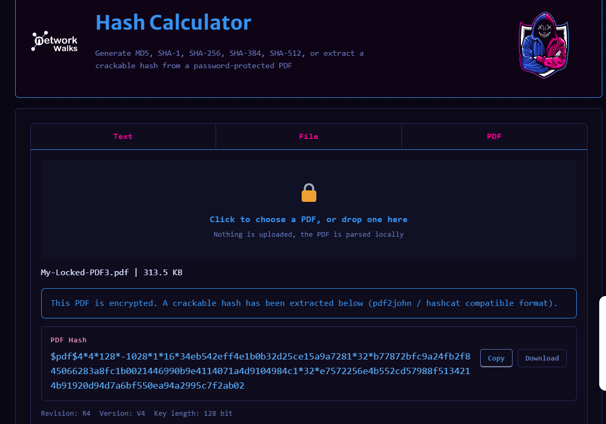
  <h3> Password Cracker</h3>
   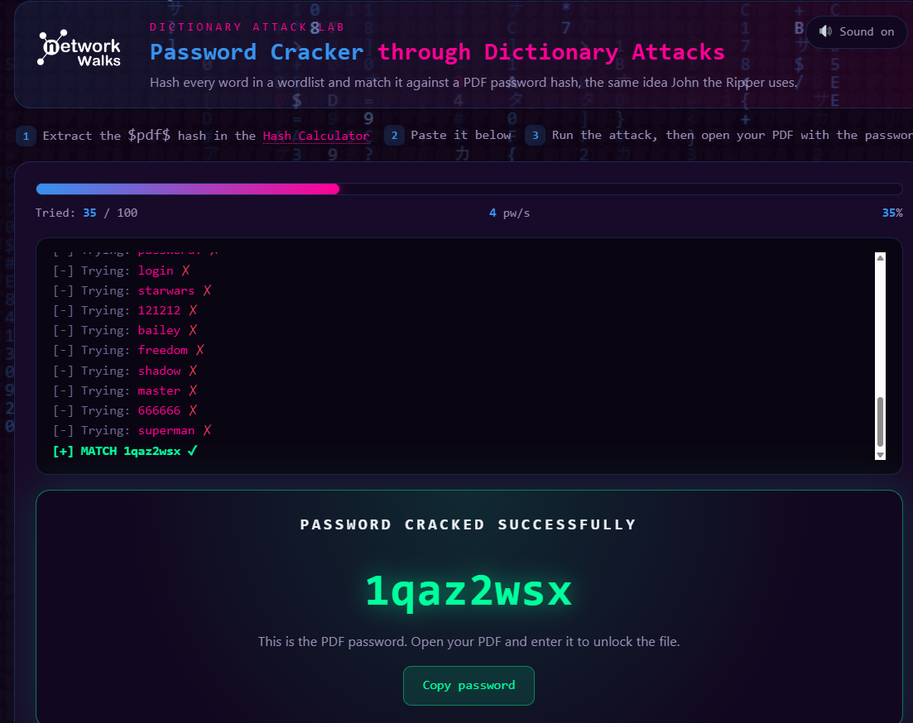
   <h3> Password Recovery</h3>
   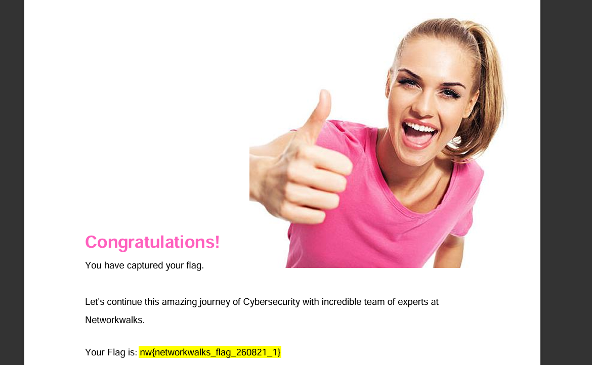
## 🛠️ Key Concepts Learned

- Password Cracking
- Password Hashing
- Hash Extraction
- Dictionary-Based Password Cracking
- Password Strength
- File Security

## 🎓 Learning Outcomes

Gained practical experience with password-cracking tools, learned how password hashes are extracted and analyzed, and understood the importance of creating strong passwords to protect sensitive files.

